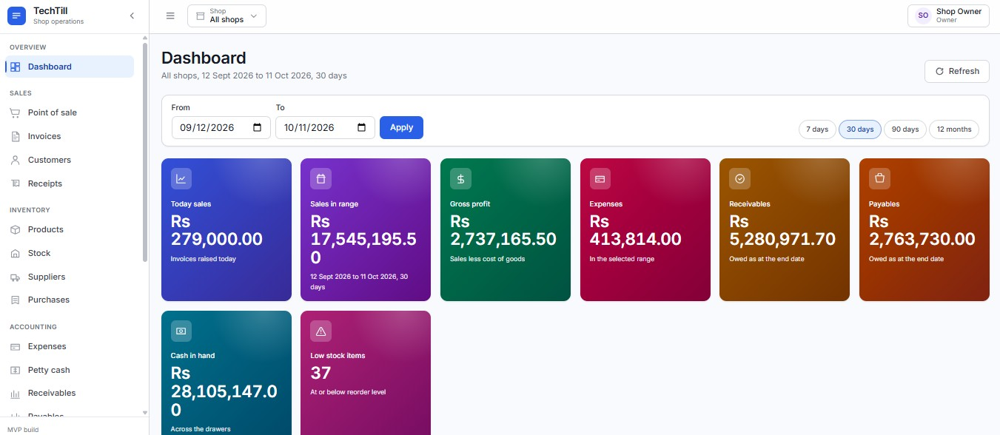
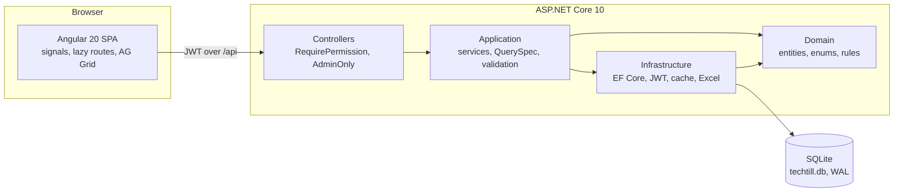

# TechTill

Multi-shop point of sale, inventory and small-business accounting, built as one ASP.NET Core API and one Angular app.

Repository: <https://github.com/asimhashmi47/Tech-Till>

A shopkeeper running two or three branches needs the till, the stock on the shelf and the books to agree with each other. TechTill keeps them in one database: a sale at the counter moves stock, raises an invoice, posts to the customer account and lands in the cash drawer, and the balance sheet that comes out at the end is one that actually balances.



## What it does

**Selling**
- Touch-friendly till with barcode or text search, category filters and keyboard shortcuts (`F2` search, `F9` take payment)
- Cash, card, bank and credit, with change due and part payment onto the customer account
- Invoices with print view, void with full stock reversal, and a receipt ledger per customer

**Inventory**
- Products with SKU, barcode, brand, category, cost and sale price, and a reorder level
- Per-shop stock with a movement history: opening, purchase, sale, adjustment, transfer and sale reversal
- Transfers between shops, and a low-stock list on the dashboard

**Buying**
- Purchase bills that put stock on the shelf and anything unpaid onto the supplier account
- Supplier payments against a specific bill, or oldest-first across the account

**Accounting**
- Expenses by category, and a petty cash drawer per shop that mirrors cash movements automatically
- Receivables and payables ageing, by party or by document, in current / 1-30 / 31-60 / 61-90 / 90+ buckets
- Profit and loss, balance sheet and a direct-method cash flow statement
- Customer and supplier ledgers that close on the same figure as the party balance

**Running the place**
- Any number of shops; every screen can show one shop or all of them
- Date range on the dashboard and the reports, with a calendar picker and 7 / 30 / 90 day and 12 month presets
- Per-module read and write permissions for each user, enforced in the API, not just the menu
- Audit log of logins, edits, voids, exports and permission changes
- Currency chosen once in Settings and applied to every money figure in the app
- Excel export from every grid, generated server side

## Screens

| | |
|---|---|
| Dashboard | KPI cards that link through to the data behind them, sales and expense charts, low stock |
| Point of sale | Product grid, cart, payment and change |
| Invoices, Customers, Receipts | Lists, detail drawers, ledgers, print |
| Products, Stock, Suppliers, Purchases | Catalogue, movements, transfers, bills |
| Expenses, Petty cash | Category spend and drawer movements |
| Receivables, Payables | Ageing with bucket summary |
| Reports | Summary, profit and loss, balance sheet, cash flow |
| Shops, Users, Settings, Audit log | Admin |

Screenshots live in [`images/`](images/).

## Tech stack

**Backend**
- .NET 10, ASP.NET Core Web API
- Clean Architecture: `Domain` ← `Application` ← `Infrastructure` ← `Api`
- EF Core 10 with SQLite in WAL mode
- JWT access and refresh tokens, BCrypt password hashing
- Serilog, RFC 7807 problem details, ClosedXML for Excel export
- Swagger UI in development

**Frontend**
- Angular 20, standalone components, signals, lazy routes
- AG Grid Community 33 using the infinite row model, so sorting, filtering and paging happen on the server
- Chart.js 4 with ng2-charts 8
- SweetAlert2 for toasts and confirms
- SCSS design tokens in OKLCH, light theme, WCAG AA contrast

## Architecture



Grids share one contract. Every list screen posts a `QuerySpec` to `POST /api/{resource}/query`, naming the page, sort and filters it wants. Fields are matched against a per-resource whitelist before any expression is built, so a filter cannot reach a column the screen was never given.

## Folder structure

```
TechTill/
├── backend/
│   ├── Directory.Build.props        net10.0, nullable, warnings as errors
│   ├── .editorconfig                analyzer rules
│   ├── src/
│   │   ├── TechTill.Domain/         entities, enums, no dependencies
│   │   ├── TechTill.Application/    services, DTOs, query contract, validation
│   │   ├── TechTill.Infrastructure/ EF Core, migrations, seeding, JWT, cache, Excel
│   │   └── TechTill.Api/            controllers, middleware, auth, Swagger
│   └── tests/
│       ├── TechTill.UnitTests/
│       └── TechTill.IntegrationTests/
├── frontend/
│   ├── proxy.conf.json              /api → http://localhost:5080
│   └── src/
│       ├── styles/                  design tokens and shared UI classes
│       └── app/
│           ├── core/                auth, guards, interceptors, services
│           ├── shared/              shell, grid, drawer, cards, alerts
│           └── features/            one folder per screen, lazy loaded
├── docs/
├── images/
└── README.md
```

## Prerequisites

- [.NET SDK 10](https://dotnet.microsoft.com/download) or newer
- [Node.js 20](https://nodejs.org/) or newer, with npm

No database server is needed. SQLite is a file, and migrations plus the demo seed run on first start.

## Quick start

Two terminals.

**API**

```bash
cd backend/src/TechTill.Api
dotnet user-secrets set "Jwt:Secret" "replace-this-with-at-least-32-characters"
dotnet run
```

The API listens on `http://localhost:5080`. Swagger UI is at `http://localhost:5080/swagger`.

In `Development` a placeholder signing key ships in `appsettings.Development.json`, so `dotnet run` works without the user-secrets step while you are trying it out. Set a real secret before running anything that matters.

Windows holds an exclusive lock on the host executable of a running app, so building while the API is up normally fails on copying `apphost.exe`. A Debug build on Windows therefore stops the previous instance first. Pass `-p:StopRunningApiBeforeBuild=false` to keep a running instance alive.

**Web**

```bash
cd frontend
npm install
npm start
```

Open `http://localhost:4200`. The dev server proxies `/api` to the backend, so there is nothing else to configure.

On first start the database is created at `backend/src/TechTill.Api/techtill.db` and seeded with two shops, a product catalogue, customers, suppliers and six months of sales, purchases, expenses and cash movements, so every report has something real to show. Delete the file to start again.

## Demo accounts

Seeded for local use only. Password for all of them: `TechTill#2026`.

| Username | Role | Access |
|---|---|---|
| `admin` | Admin | Everything, including users, settings and the audit log |
| `sara` | Standard | Writes POS, invoices, customers. Reads dashboard, products, stock. Shop 1 |
| `bilal` | Standard | Writes POS, invoices, customers, expenses, petty cash. Reads reports. Shop 2 |
| `hina` | Standard | Writes products, stock, purchases, suppliers. Reads invoices, reports. Both shops |
| `omar` | Standard | Writes expenses, petty cash. Reads reports, invoices. Both shops |
| `zoya` | Standard | Read only, shop 1 |

Change them before deploying anywhere.

## Configuration

Settings come from `appsettings.json`, then the environment, then user secrets.

| Key | Environment variable | Notes |
|---|---|---|
| `Jwt:Secret` | `JWT__SECRET` | Required, at least 32 characters. The app refuses to start without it |
| `Jwt:Issuer` / `Jwt:Audience` | `JWT__ISSUER` / `JWT__AUDIENCE` | Default `TechTill` |
| `Jwt:AccessTokenMinutes` | `JWT__ACCESSTOKENMINUTES` | Default 30 |
| `Jwt:RefreshTokenDays` | `JWT__REFRESHTOKENDAYS` | Default 7 |
| `ConnectionStrings:Default` | `CONNECTIONSTRINGS__DEFAULT` | Default `Data Source=techtill.db` |
| `Cors:AllowedOrigins` | `CORS__ALLOWEDORIGINS__0` | Default `http://localhost:4200` |

Never commit a real signing key. Use `dotnet user-secrets` locally and environment variables in deployment.

## Roles and permissions

Two roles. **Admin** has everything and is the only role that can reach Users, Settings and the Audit log. **Standard** gets read or write per module, granted by an admin on the Users screen.

Modules: Dashboard, Shops, Products, Stock, Pos, Invoices, Customers, Suppliers, Purchases, Expenses, PettyCash, Reports, Users, AuditLog, Settings.

Permission is enforced on the server with `[RequirePermission(Module, Access)]` and `[AdminOnly]` attributes. Hiding a menu item is a convenience; the API refuses the call either way, and the same check decides which shops a user may see.

## Testing

```bash
cd backend
dotnet test
```

Both test projects are wired into the solution and currently hold a single placeholder test each. Filling them out, starting with the accounting identities the reports already assert at runtime, is the next piece of work.

The UI has been checked in the browser against live seed data: every route for console errors, text contrast against WCAG AA, grid sorting, filtering and paging, permission enforcement with a lower-privilege token, and the accounting identities (assets equal liabilities plus equity, ageing totals match the balance sheet, ledger closing matches the party balance).

## Security notes

- Passwords are hashed with BCrypt. They are never logged and never returned by the API
- Access tokens are short lived; refresh tokens are stored server side and revoked on sign-out
- Every list query is matched against a field whitelist before an expression is built
- A strict Content-Security-Policy is applied by middleware; fonts ship with the app rather than coming from a CDN
- Errors come back as RFC 7807 problem details, without stack traces outside development
- Logins, failures, edits, voids, exports and permission changes are written to the audit log

The demo credentials above are seed data for a local database. Treat them as examples, not as defaults to deploy.

## Roadmap

- Fill out the unit and integration test projects
- Due dates on invoices, so ageing runs from the date the money was actually due
- Tax and multi-currency pricing, rather than one display currency
- Barcode label printing
- A dark theme using the existing token layer

## Contributing

Issues and pull requests are welcome at <https://github.com/asimhashmi47/Tech-Till>.

Please keep the backend building with zero warnings (the solution treats warnings as errors outside the test projects), run `dotnet build` and `npm run build` before opening a pull request, and match the surrounding style rather than introducing a new one.

## License

MIT. See [LICENSE](LICENSE).
